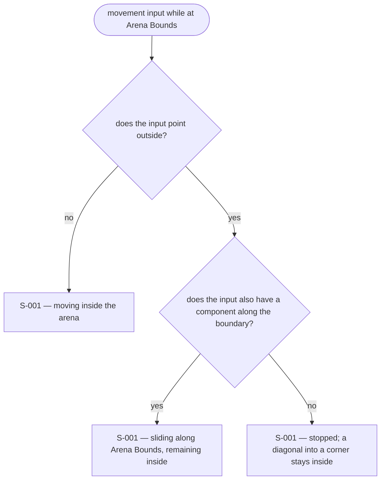
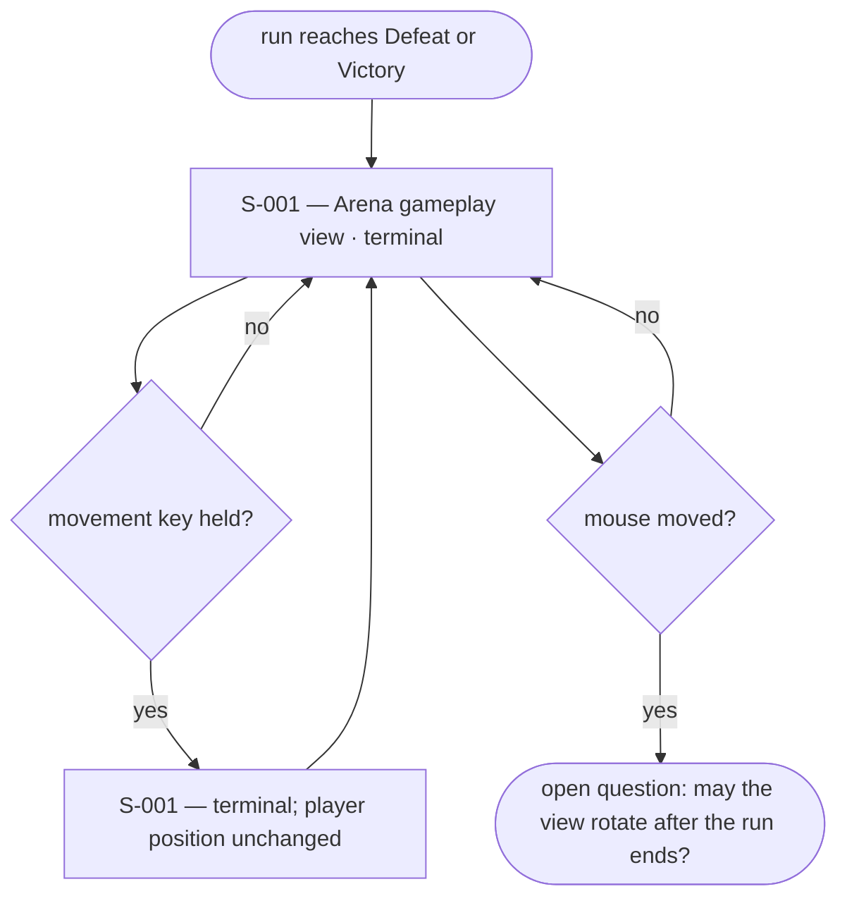

# UX Flows

Feature F-001 — Player movement and third-person camera.

### FL-001 — Arena view and movement

Primary flow. Complete.

### FL-002 — Arena Bounds containment

Edge flow. Complete.

### FL-003 — Movement after the run ends

Edge flow — `provisional`.

## Open questions

- FL-003 is provisional: the spec fixes movement only and does not state whether the view may still rotate after the player dies (US-005 note). Returned to `product-role`.
