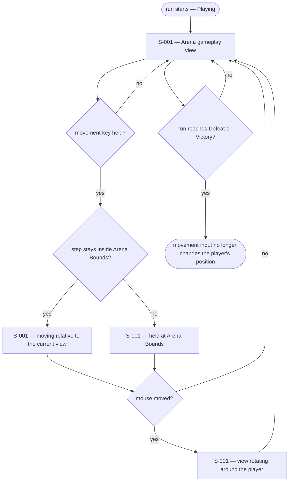
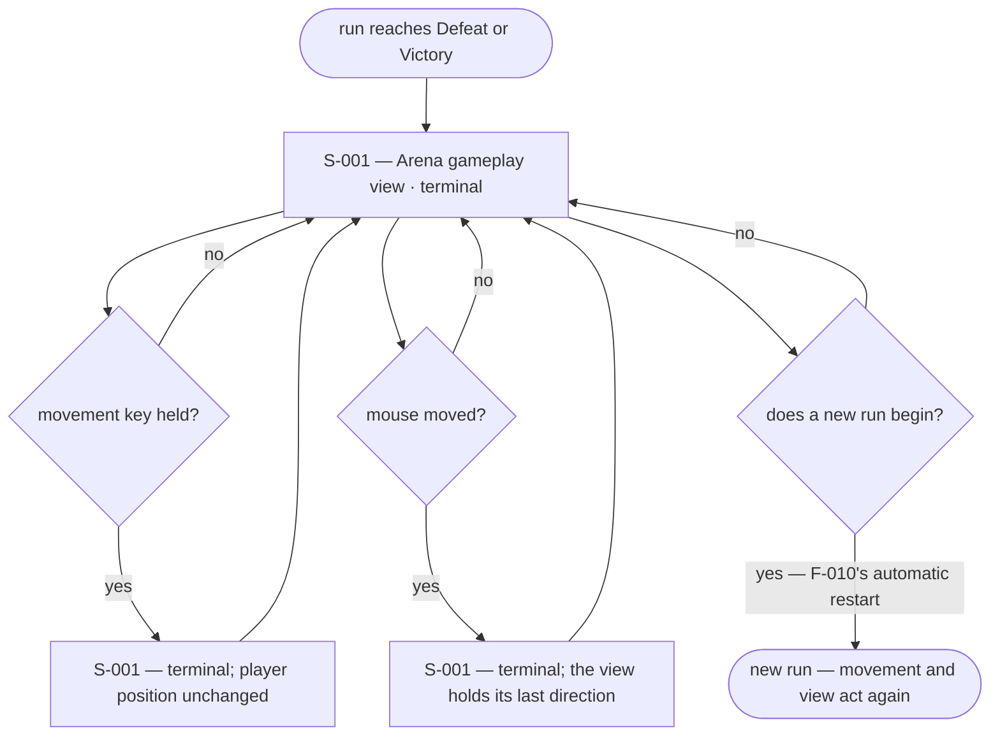

# UX Flows

Feature F-001 — Player movement and third-person camera.

### FL-001 — Arena view and movement

Primary flow. Complete.

### FL-002 — Arena Bounds containment

Edge flow. Complete.

### FL-003 — Movement and view after the run ends

Edge flow. Complete. Settled by F-001b.

## Open questions

- None. F-001b settles the only question F-001 carried: once the run ends — by Defeat or by Victory — the view no longer rotates in response to input and holds its last direction (spec R7, A6).
