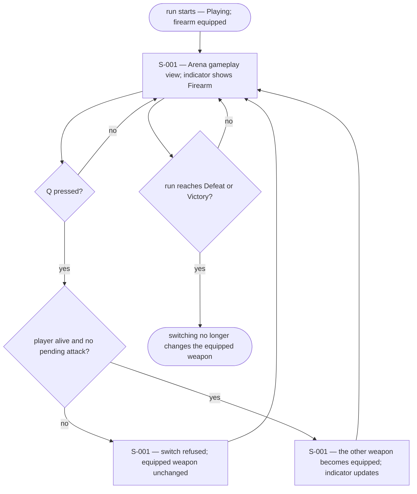
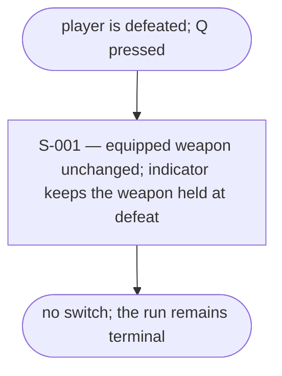
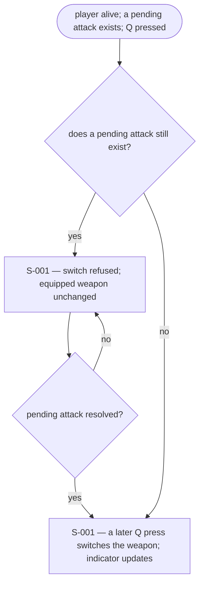
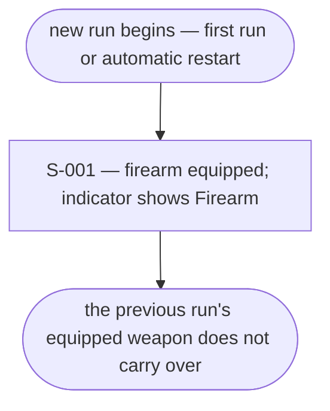
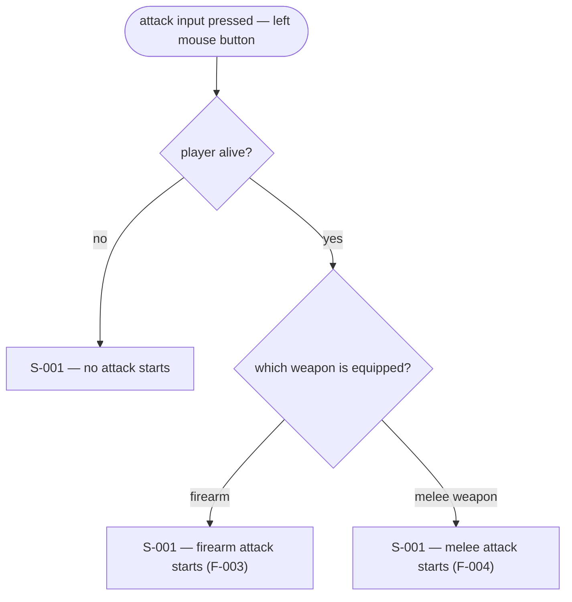

# UX Flows

Feature F-002 — Weapon switching.

### FL-004 — Weapon switch while alive

Primary flow. Complete.

### FL-005 — Weapon switch refused while dead

Edge flow. Complete.

### FL-006 — Weapon switch refused during a pending attack

Edge flow. Complete.

### FL-007 — A new run starts with the firearm

Edge flow. Complete.

### FL-008 — Attack input follows the equipped weapon

Edge flow. Complete.

## Notes

- F-002 routes the attack input; whether the attack itself starts, and its timing, are F-003 and F-004.
- The equipped-weapon indicator is part of S-001, not a screen of its own.

## Open questions

- None. The spec and analysis settle F-002's behaviour, and the persistent equipped-weapon indicator was selected by the user on 2026-10-23.
