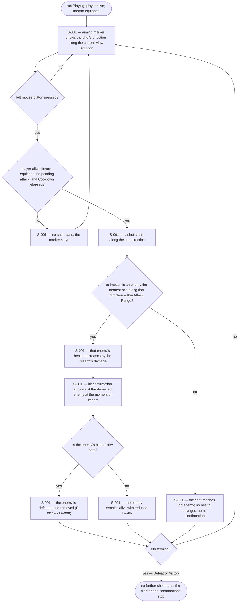
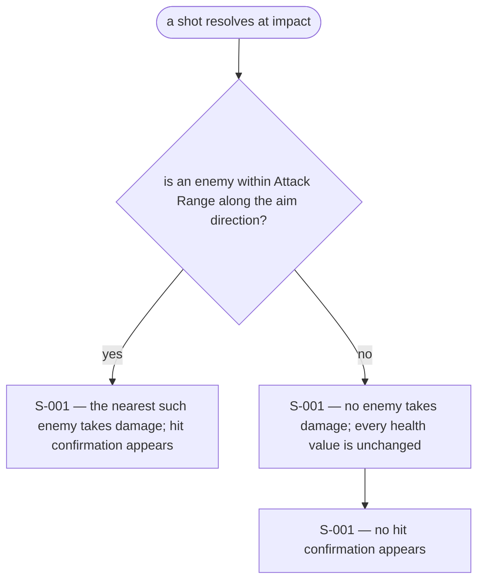
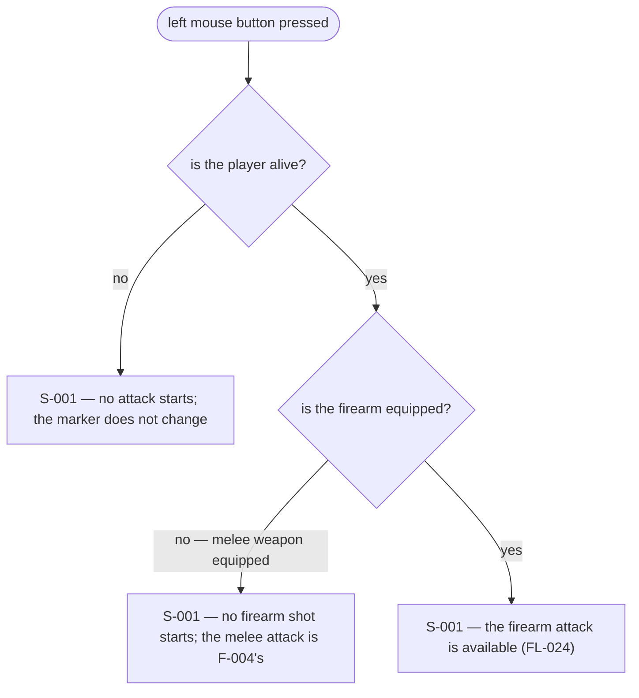
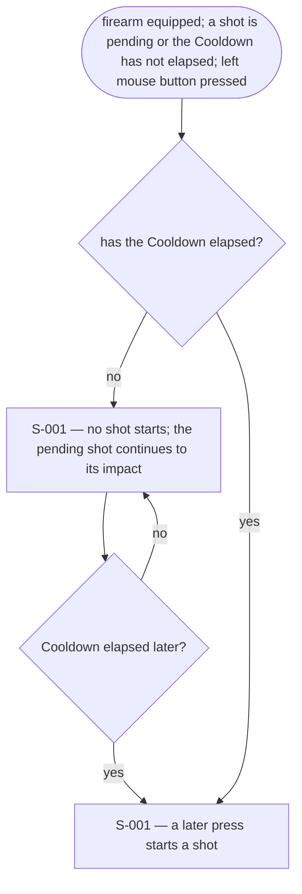
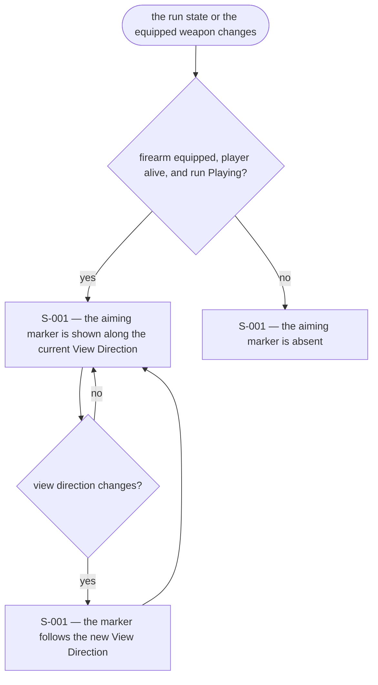

# UX Flows

Feature F-003 — Firearm attack.

### FL-024 — Firearm attack during a run

Primary flow. Complete.

### FL-025 — A shot that misses

Edge flow. Complete.

### FL-026 — Firearm attack refused

Edge flow. Complete.

### FL-027 — Firearm attack during Cooldown

Edge flow. Complete.

### FL-028 — Aiming marker availability

Edge flow. Complete.

## Notes

- The aiming marker is present while the firearm is equipped, the player is alive, and the run is Playing. A momentary Cooldown does not hide it: R8's "can be fired" is read as R7's availability — equipped and alive — not as the instant readiness of one shot. The marker shows the current View Direction, which is the Aim Direction.
- The hit confirmation is tied to Damage actually applied. A shot that reaches no enemy produces none (R9, A9).
- Attack Start applies no Damage and Impact resolves against the state at impact time (BR-092, BR-095), so the flow checks the target at impact, not at the press.
- F-002 routes the attack input to the equipped weapon; F-003 defines what the firearm does once routed. F-004 defines the melee case.

## Open questions

- None.
