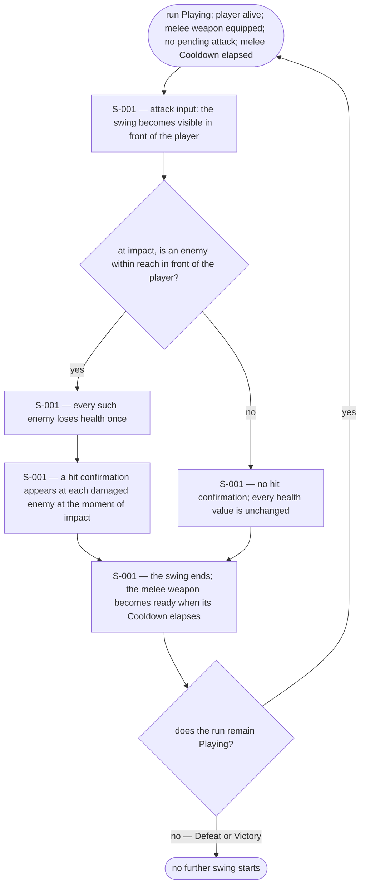
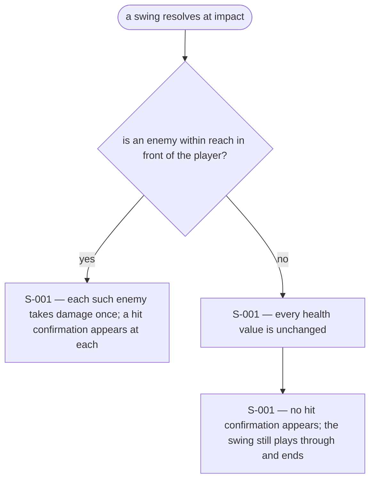
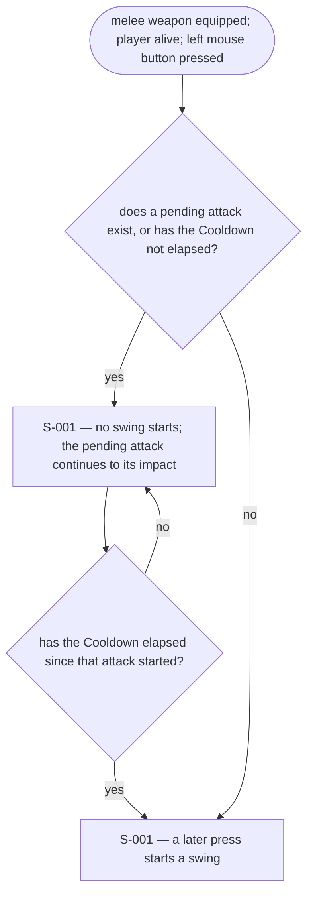
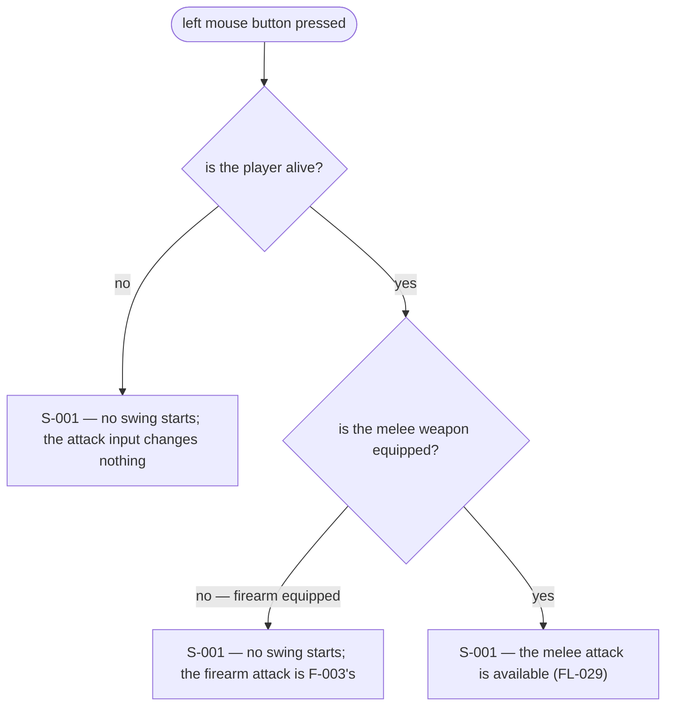
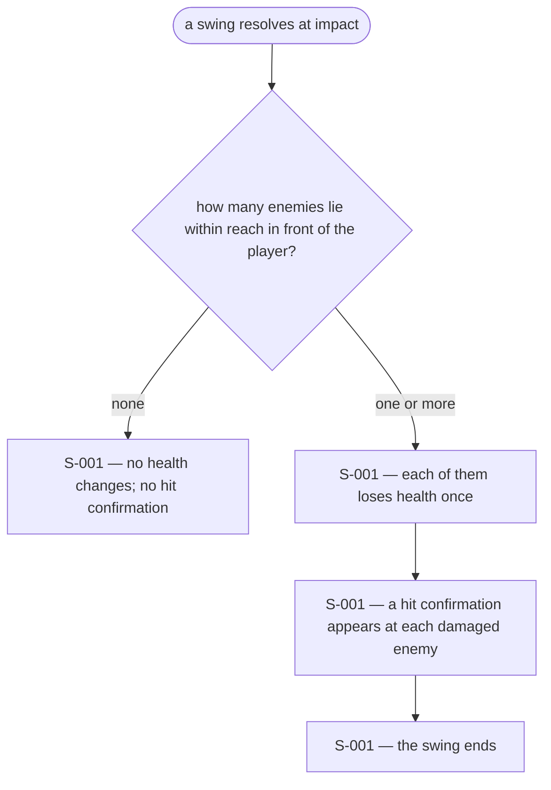
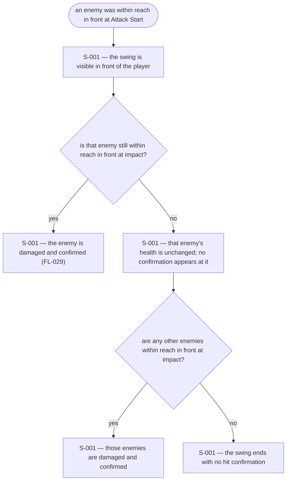

# UX Flows

Feature F-004 — Melee attack.

### FL-029 — Melee swing that damages enemies in front

Primary flow. Complete.

### FL-030 — A swing that damages nothing

Edge flow. Complete.

### FL-031 — Melee attack refused by readiness

Edge flow. Complete.

### FL-032 — Attack input with the firearm equipped or the player defeated

Edge flow. Complete.

### FL-033 — Several enemies within reach in front

Edge flow. Complete.

### FL-034 — An enemy leaves reach before impact

Edge flow. Complete.

## Notes

- The swing is the melee attack's visible form: in-world, in front of the player, and transient. It is the only surface R7 asks for; no standing reach indicator or HUD control is added.
- The hit confirmation is tied to Damage actually applied. One appears at each enemy that lost health (R8, A7); a swing that damages nothing produces none.
- Attack Start applies no Damage, and Impact resolves against the state at impact time (BR-092, BR-095), so the flow checks targets at impact, not at the press.
- Melee affects every enemy within Attack Range in front of the player within the Attack Arc, once each (BR-115, BR-098); enemies beyond reach or behind the player are spared (BR-116).
- F-002 routes the attack input to the equipped weapon; F-004 defines the melee case, as F-003 defines the firearm case.
- When the run reaches Defeat or Victory, no further swing starts. A swing still pending at that moment applies no Damage and produces no hit confirmation (BR-014, BR-023, BR-102); the swing's visible form ends with it.

## Open questions

- None.
