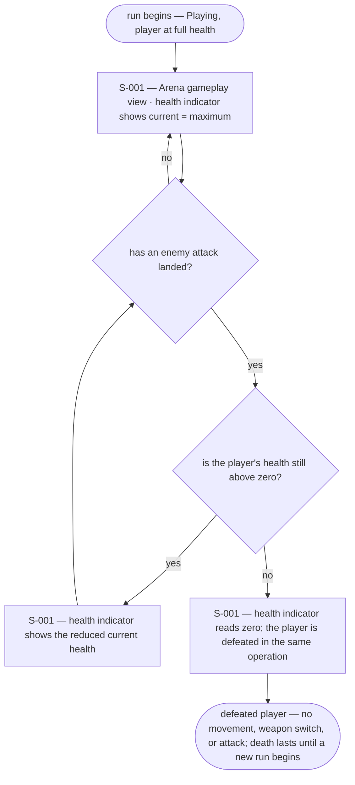
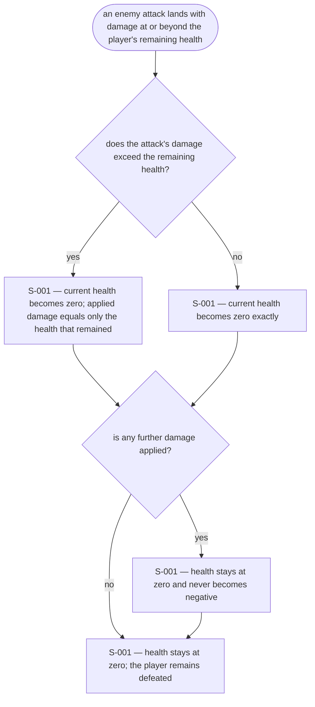
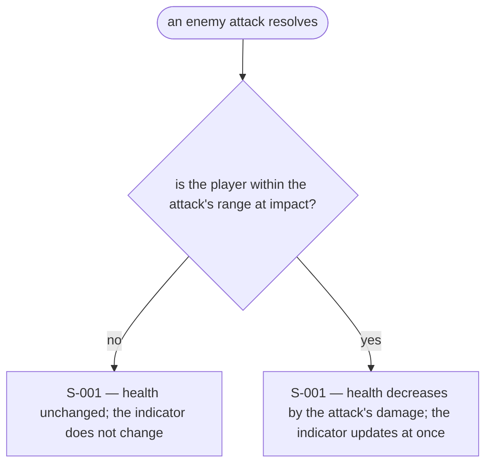
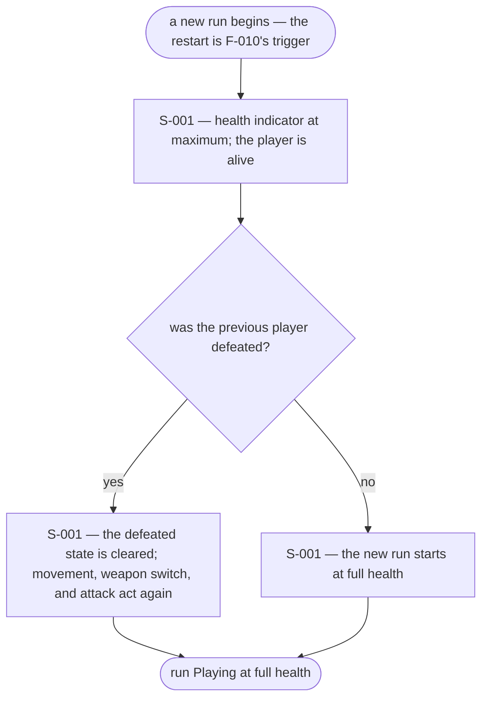

# UX Flows

Feature F-005 — Player health and death.

### FL-009 — Health, damage, and death during the run

Primary flow. Complete.

### FL-010 — Damage at or beyond the remaining health

Edge flow. Complete.

### FL-011 — An attack that does not land changes nothing

Edge flow. Complete.

### FL-012 — A new run restores full health

Edge flow. Complete.

## Open questions

- None for F-005. The inherited F-001 FL-003 question — whether the view may rotate after the player dies — was settled by F-001b on 2026-10-23: the view freezes once the run ends.
