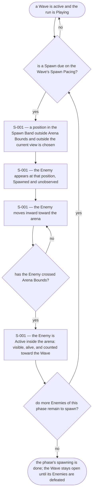
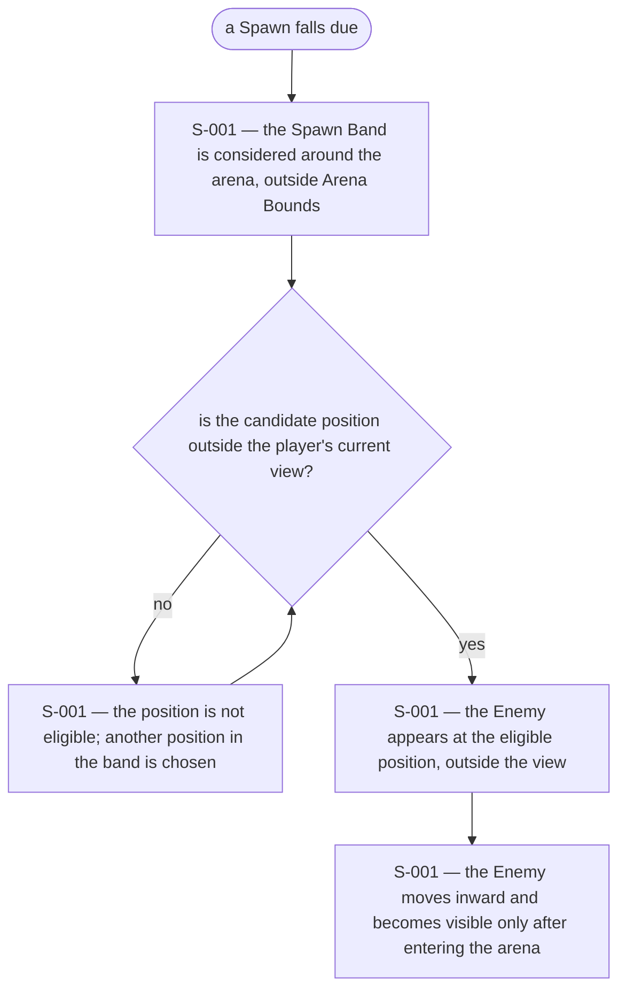
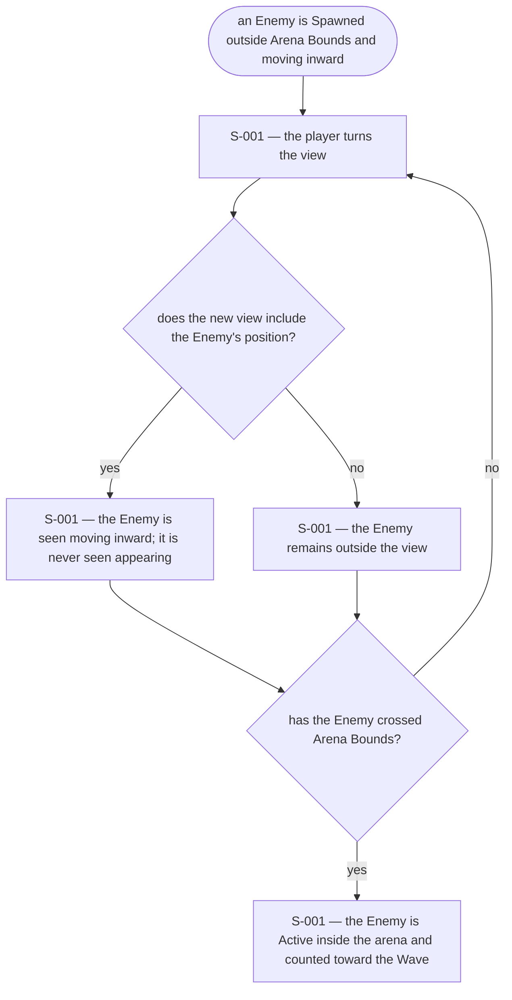
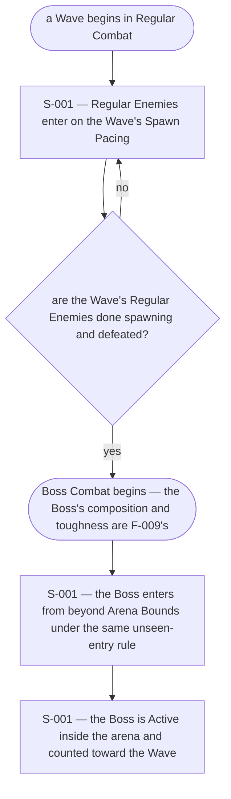
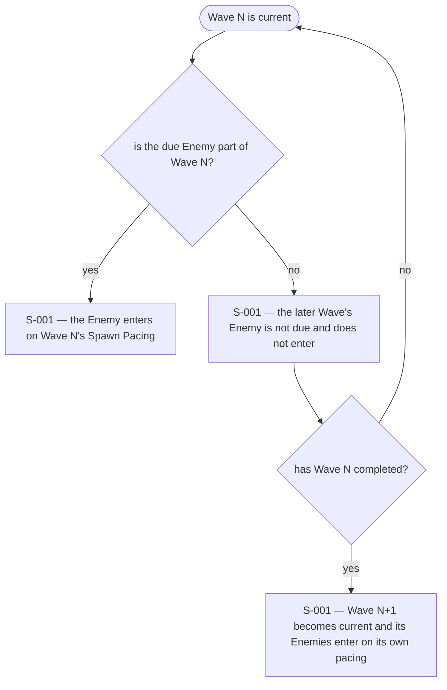
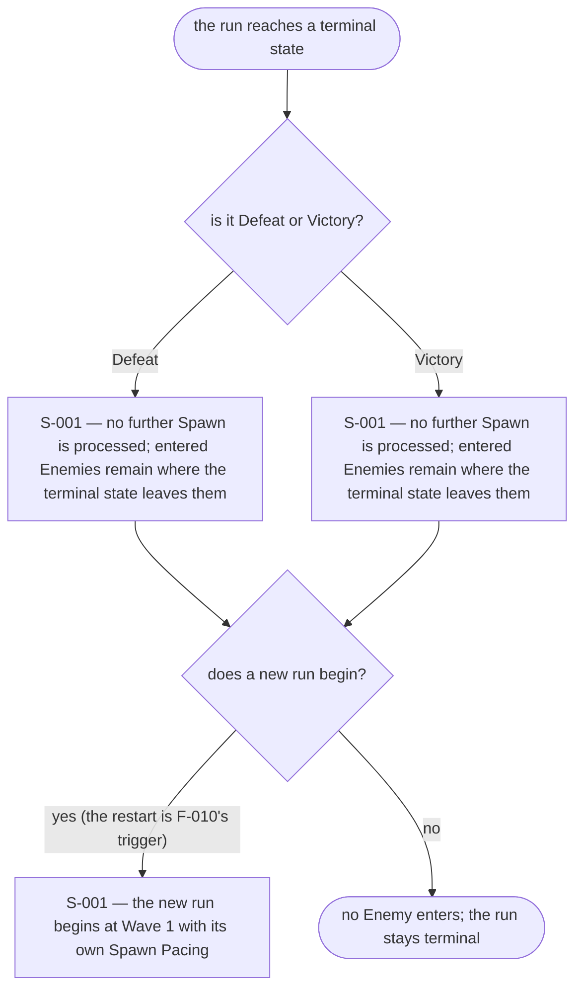

# UX Flows

Feature F-006 — Enemy spawning outside the arena, unseen.

### FL-013 — Enemies enter the arena from beyond its bounds, unseen

Primary flow. Complete.

### FL-014 — A due spawn while the player looks toward the Spawn Band

Edge flow. Complete.

### FL-015 — The player turns the view during an entry

Edge flow. Complete.

### FL-016 — Regular and Boss spawns belong to their combat phases

Edge flow. Complete.

### FL-017 — A later Wave's enemies wait their turn

Edge flow. Complete.

### FL-018 — Spawning stops when the run ends

Edge flow. Complete.

## Open questions

- None for F-006. Enemy count, spawn positions, and pacing are tuning
  values; spawn effects, telegraphs, audio, wave composition, and
  difficulty scaling are out of scope in the spec.
