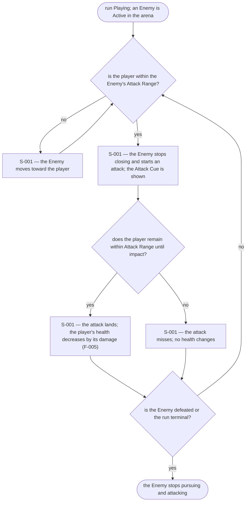
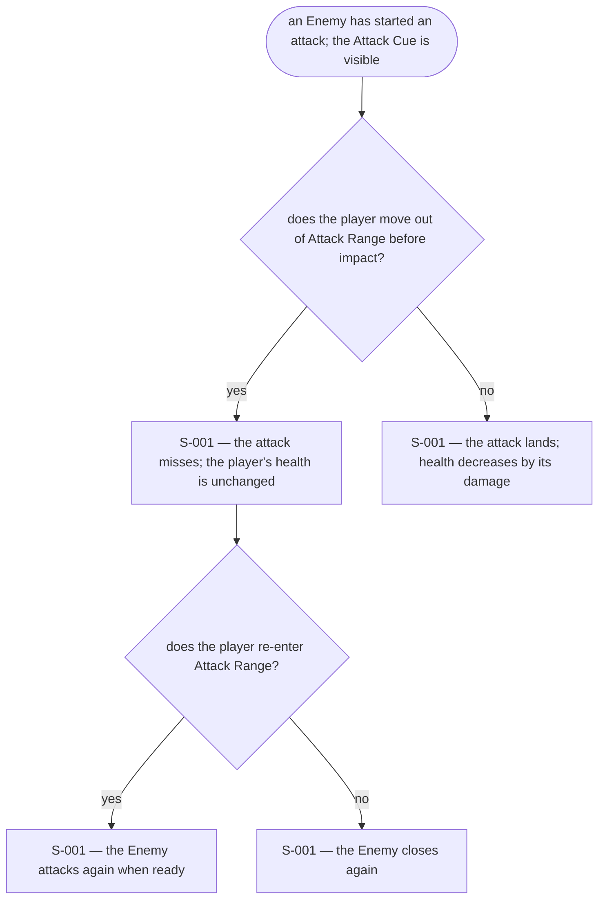
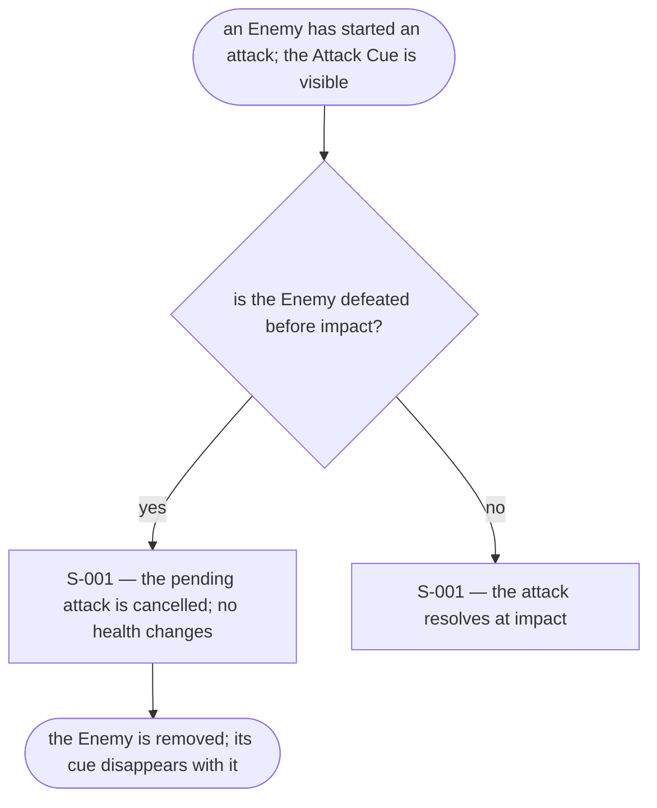
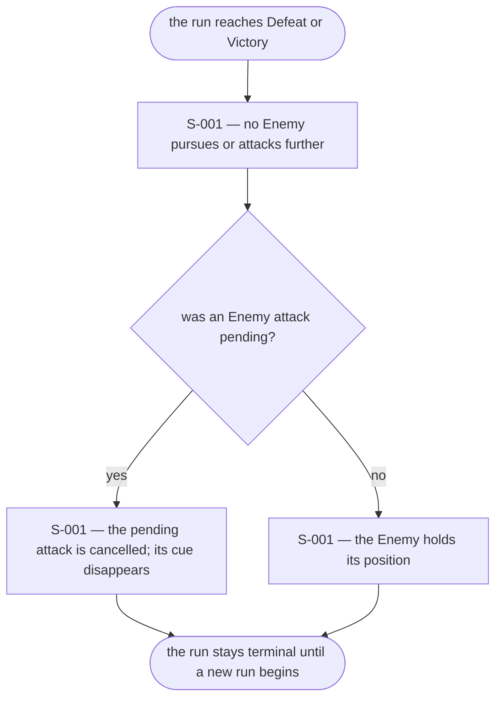
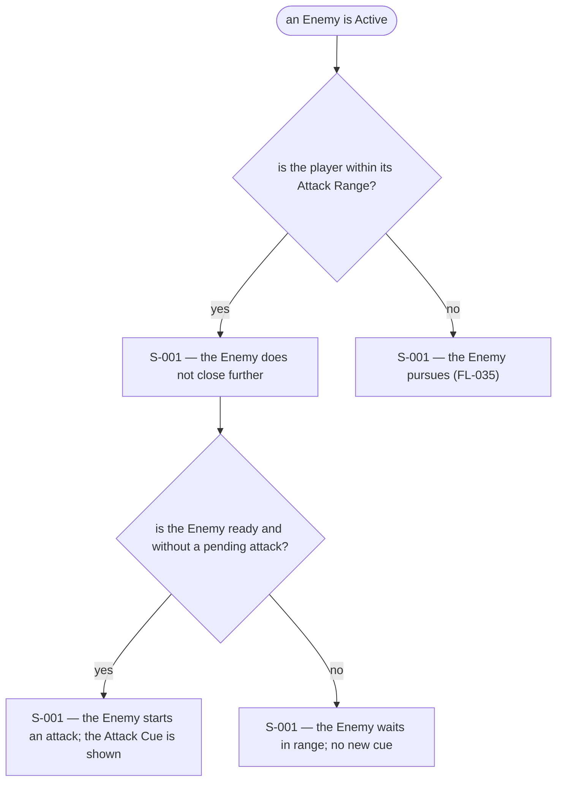

# UX Flows

Feature F-007 — Enemy pursuit and close-range attack.

### FL-035 — Pursuit, cue, and attack

Primary flow. Complete.

### FL-036 — The player leaves range during the wind-up

Edge flow. Complete.

### FL-037 — The Enemy is defeated during the wind-up

Edge flow. Complete.

### FL-038 — The run ends during pursuit or wind-up

Edge flow. Complete.

### FL-039 — An Enemy in range attacks without closing

Edge flow. Complete.

## Notes

- Pursuit is in-world movement: the Enemy is seen closing on the player. It is not a HUD indicator and adds no control.
- The Attack Cue is a visible signal at the attacking Enemy. It is shown when the attack starts and remains visible until the attack resolves or is cancelled, so it always precedes the damage (R6, A6; BR-120).
- The cue's duration is a tuning value; its ordering before damage is fixed. The design does not fix a duration.
- The attack's impact checks range again (BR-100), so leaving range during the wind-up produces a miss, not damage.
- A defeated Enemy's pending attack is cancelled (BR-102), and the cue disappears with the Enemy.
- F-005 owns the health indicator and the damage display; F-007 adds the pursuit and the cue, not a new health surface.

## Open questions

- None.
