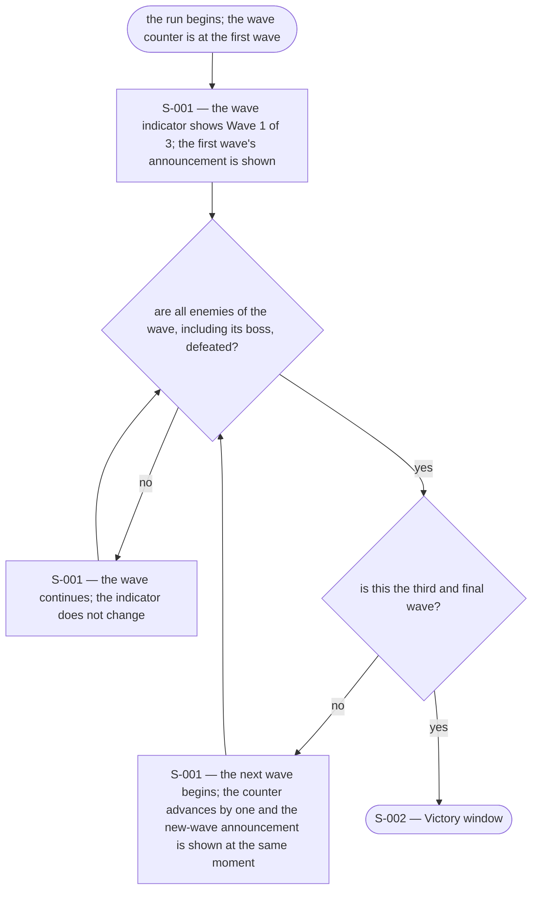
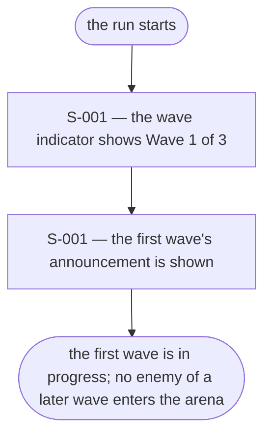
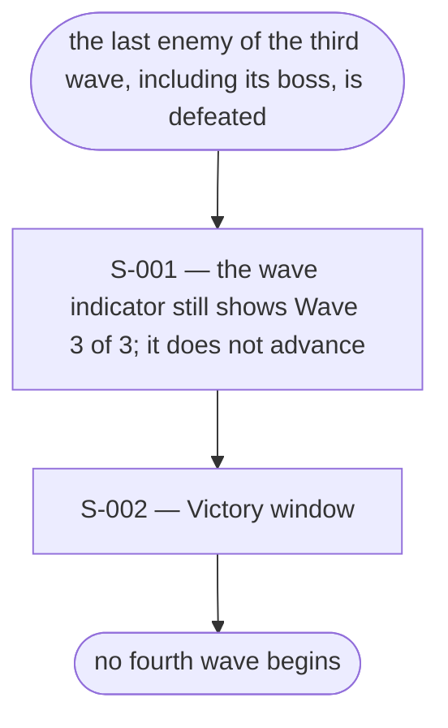
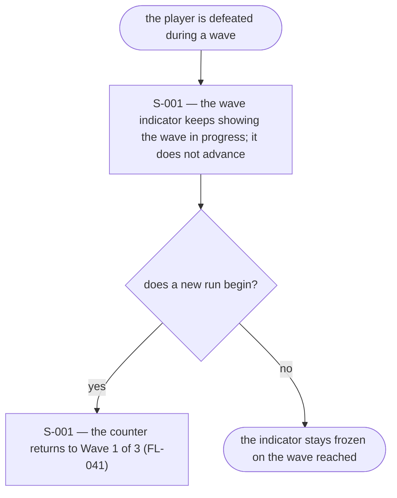

# UX Flows

Feature F-008 — Wave progression.

### FL-040 — Wave progression through a run

Primary flow. Complete.

### FL-041 — The first wave at run start

Edge flow. Complete.

### FL-042 — The final wave is cleared

Edge flow. Complete.

### FL-043 — The run ends before the last wave

Edge flow. Complete.

## Notes

- The wave indicator is a persistent display on `S-001`: the current wave and the total, always three. It never shows a number the wave in progress does not have (A5).
- The announcement and the counter increase happen at the same moment (A6). The announcement is tied to the wave beginning, not to the previous wave being cleared.
- The first wave is announced at run start, so every wave begins the same way.
- The announcement is transient; its duration is a tuning value. The indicator is not transient.
- The final wave is the third; clearing it leads to the Victory window and no fourth wave (R6, A4).
- A defeat freezes the indicator on the wave reached; the defeat surface itself belongs to F-010, which reads the same number.
- F-008 adds no control and no new screen: `S-001` is extended, and `S-002` is reached unchanged.

## Open questions

- None.
