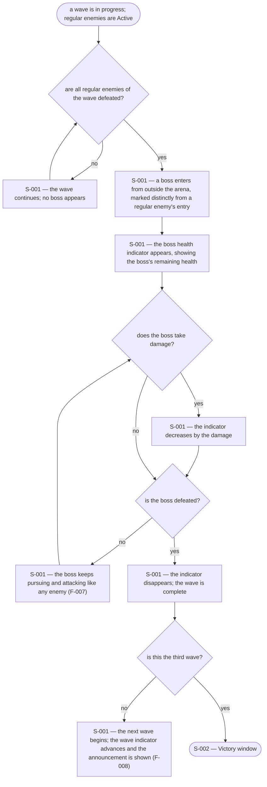
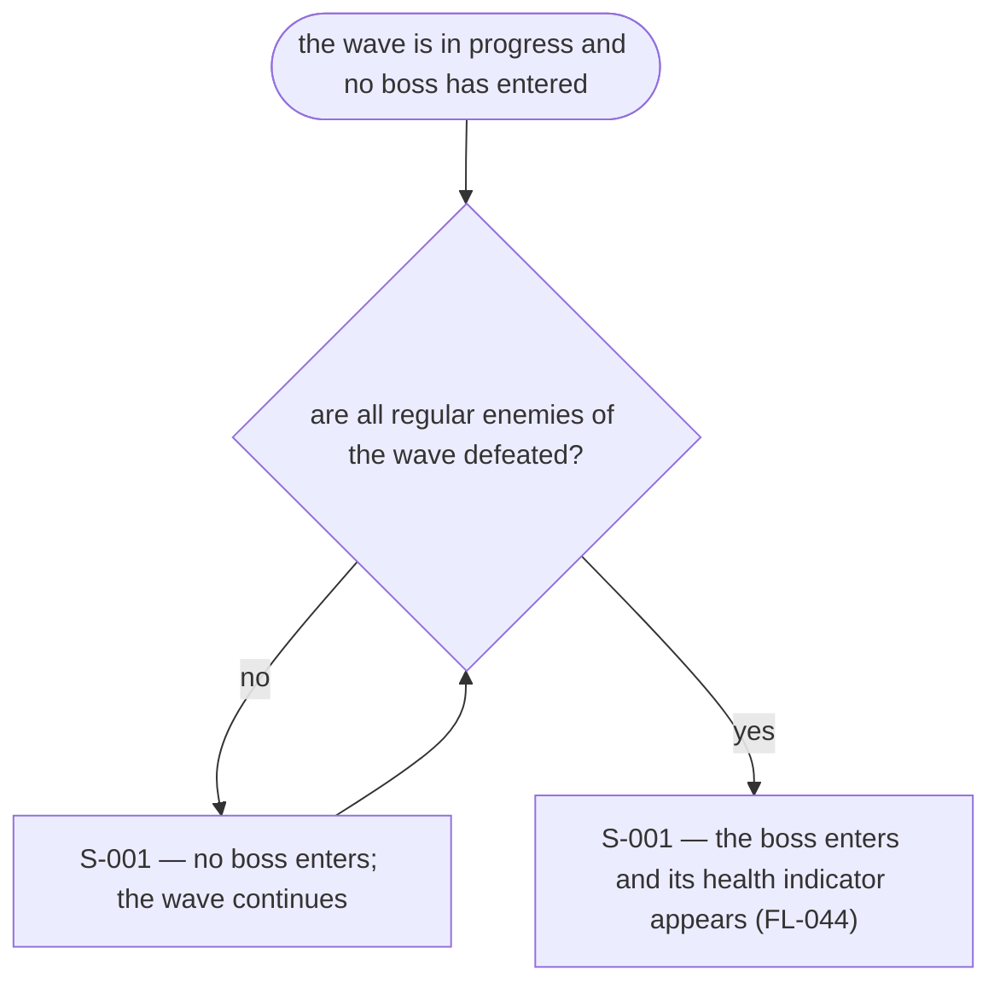
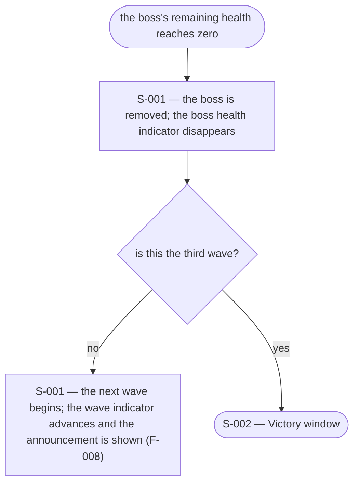
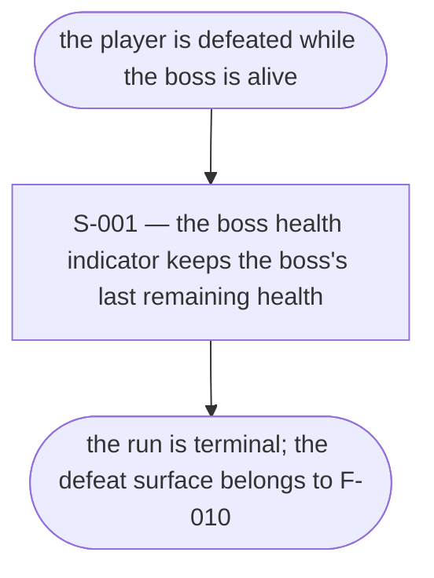

# UX Flows

Feature F-009 — Boss enemy each wave.

### FL-044 — Boss entry and the end of a wave

Primary flow. Complete.

### FL-045 — A regular enemy is still alive

Edge flow. Complete.

### FL-046 — The boss is defeated and the wave completes

Edge flow. Complete.

### FL-047 — The run ends with the boss alive

Edge flow. Complete.

## Notes

- The boss enters only after every regular enemy of the wave is defeated (R1, A1, A2). It enters from outside the arena, as regular enemies do (F-006), but its entry is marked distinctly (R6, A6).
- The boss health indicator appears with the boss and is shown only while it is alive (R7, A7). It is a HUD region labelled as the boss's, so it is never read as the player's health (F-005).
- The boss pursues and attacks like any other enemy (R3), so F-007's Attack Cue applies to it unchanged; F-009 adds no boss-specific attack surface.
- The wave is complete only when the boss is defeated (R4, A4); the next wave then begins (F-008), and the third boss's defeat leads to the Victory window (A5).
- The indicator disappears when the boss is defeated and does not linger into the next wave.
- The boss's health, size, and attack values are tuning values; the design fixes only what is shown.

## Open questions

- None.
