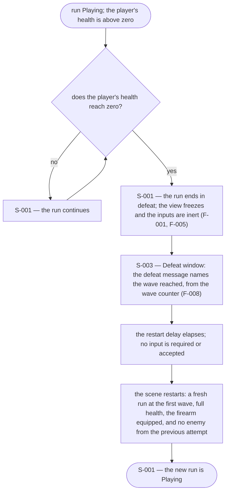
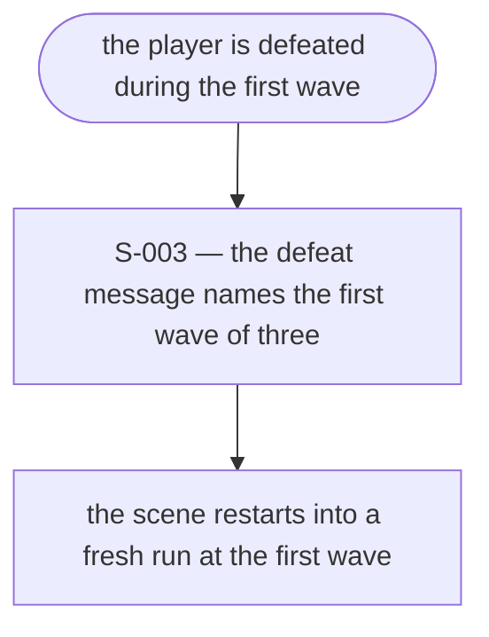
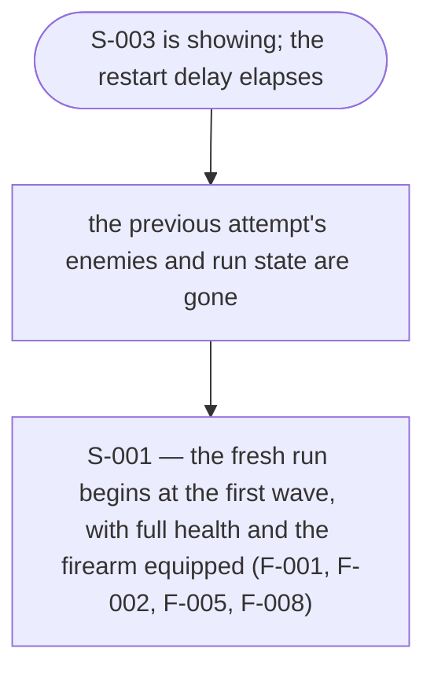
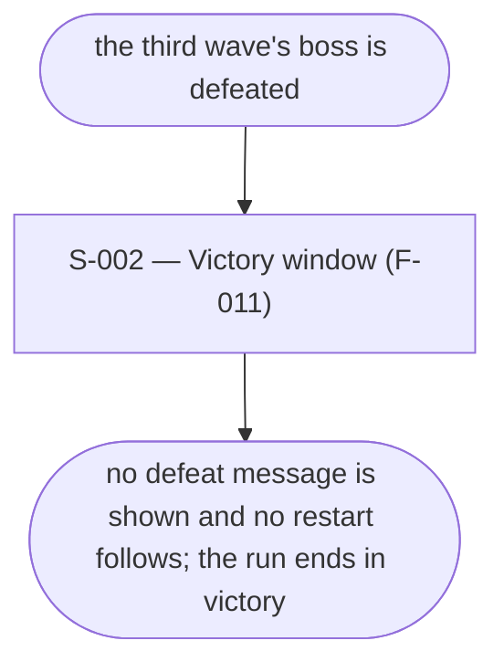

# UX Flows

Feature F-010 — Defeat and scene restart.

### FL-048 — Defeat and automatic restart

Primary flow. Complete.

### FL-049 — Defeat on the first wave

Edge flow. Complete.

### FL-050 — The restart completes into a fresh run

Edge flow. Complete.

### FL-051 — The run ends in victory instead

Edge flow. Complete.

## Notes

- `S-003` is the defeat surface and is reached only from `S-001`'s terminal defeat state. It is distinct from `S-002`, the Victory window: a different outcome, a different message, and no shared control.
- The defeat message names the wave reached, which is F-008's counter frozen at the moment of defeat (F-008 FL-043). The number the player saw on `S-001` is the number `S-003` repeats.
- `S-003` shows the message and the wave reached, and nothing else: no score, no statistics, no rewards, no restart control.
- The screen lives for the restart delay only. The delay is a tuning value; the message is shown inside it and never waits for the player (R2, A5).
- The restart is automatic: it needs no input and offers none. `S-003` is replaced by the fresh run's `S-001` when the delay ends.
- After the restart the run begins at the first wave with full health and the firearm equipped, and nothing from the previous attempt survives (R3, R4, R5).
- A victory does not pass through `S-003`; the two endings never follow one another.

## Open questions

- None.
