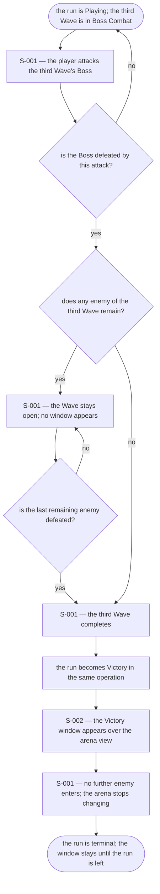
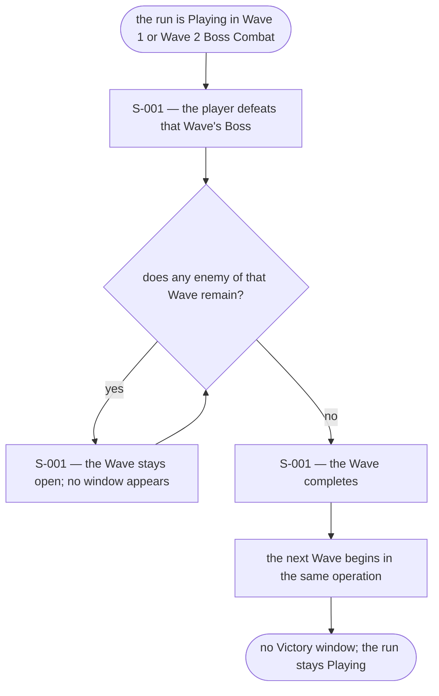
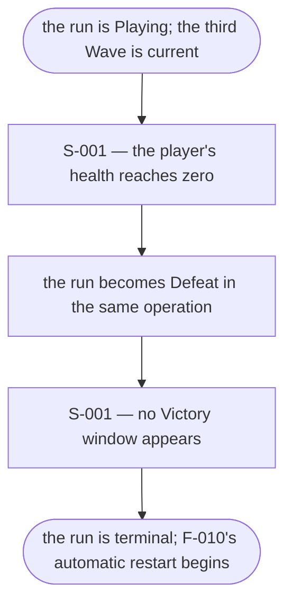
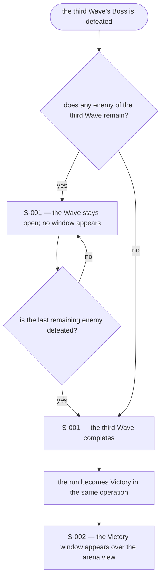
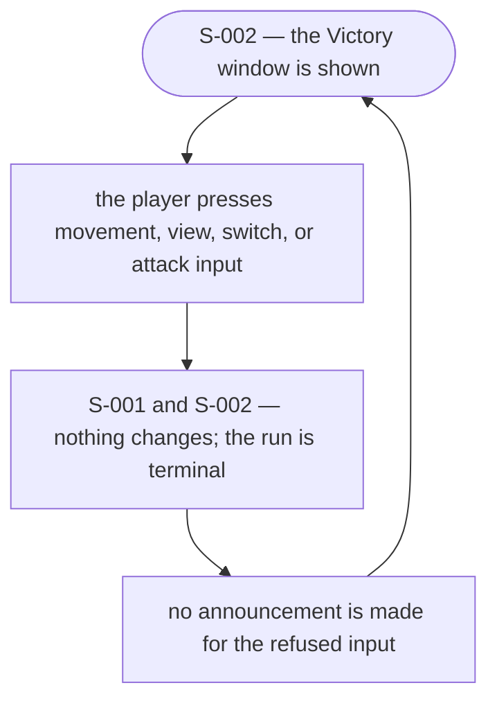

# UX Flows

Feature F-011 — Victory after three waves.

### FL-019 — Victory after the third wave's boss is defeated

Primary flow. Complete.

### FL-020 — A boss of the first or second wave is defeated

Edge flow. Complete.

### FL-021 — The player is defeated during the third wave

Edge flow. Complete.

### FL-022 — The third wave's boss is defeated while another enemy remains

Edge flow. Complete.

### FL-023 — The player acts after the Victory window appears

Edge flow. Complete.

## Open questions

- None. The trigger, the terminal behaviour, and the exclusion of
  actions, score, and animation are settled by the spec and the
  analysis. The inherited F-001 FL-003 view-rotation-after-death
  question remains provisional there and is untouched here.
